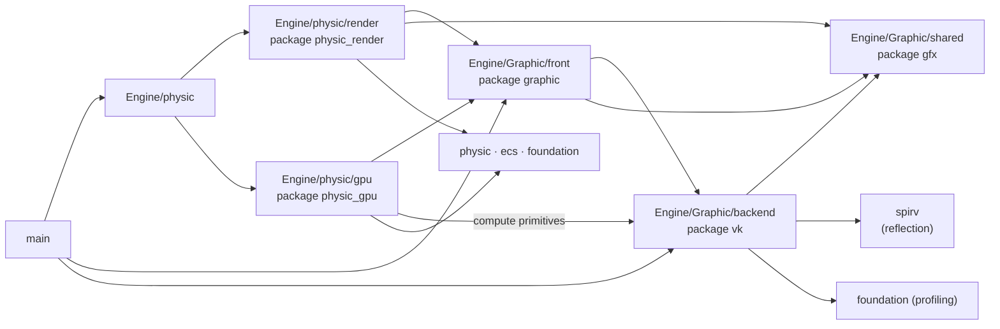
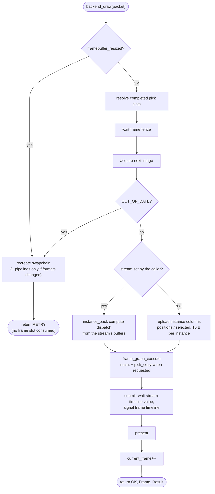
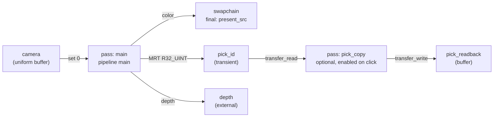
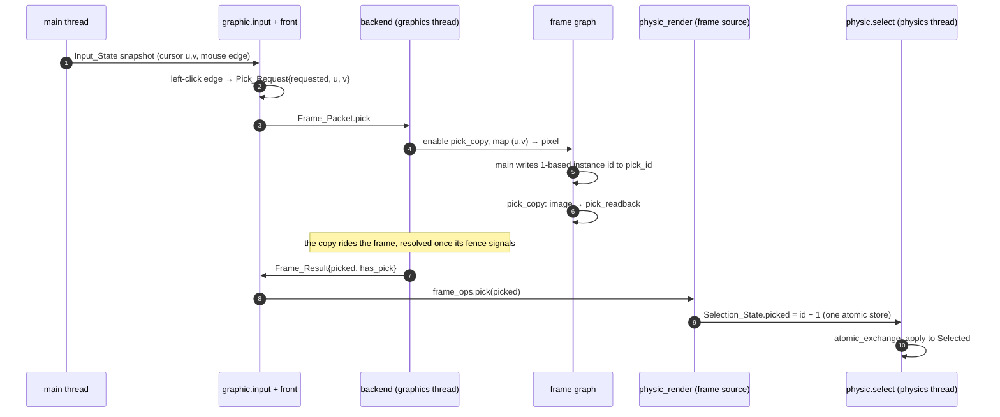

# Renderer (`Engine/Graphic`)

`Engine/Graphic` is split into three packages: `front` (package `graphic`) owns
camera, input and the frame loop; `backend` (package `vk`) owns everything that
talks to Vulkan and imports no engine state; `shared` (package `gfx`) is the
plain-data seam. The physics module integrates with graphics: `Engine/physic/render`
(package `physic_render`) supplies the CPU instance columns and the pick handoff,
and `Engine/physic/gpu` (package `physic_gpu`) supplies the GPU gravity solver and
its stream. Both depend on the front; the front depends on the backend and never
imports physics.

```
Engine/Graphic/
├── shared/    package gfx       # plain data only: no Vulkan, no ECS, no GLFW
├── front/     package graphic   # camera, input, frame loop, opaque source handles
├── backend/   package vk        # window, GPU, swapchain, pipeline, frame graph, compute,
│                                # descriptors, sync, render targets, pick, present
├── spirv/                       # unchanged (CPU-only SPIR-V reflection, used by backend)
├── shader/                      # unchanged paths (Vulkan assets)
└── frame_graph.json             # unchanged path

Engine/physic/render/   package physic_render   # CPU instance columns + pick handoff
Engine/physic/gpu/      package physic_gpu      # GPU gravity solver, GPU tree build, stream
```



Dependency rules, enforced by `scripts/check_layering.sh`:

- `physic -> front -> backend`; `main -> physic`. `main` also creates the window
  and backend for the app shell.
- The front never imports `vendor:vulkan` and never imports a physics package.
- The physics core (`Engine/physic/*.odin`) imports no graphics; only
  `physic/render` and `physic/gpu` integrate with the front.
- The backend imports no engine state: no `ecs`, no `physic`, and never the front.
- `physic_gpu` also uses the backend's compute primitives directly; the render
  handoff itself goes through the front.
- The front holds only opaque handles (`Frame_Source_Handle`, `vk.Stream_Handle`);
  the physics side implements them.

## Configuration and reflection

The pipeline is built from data, not from hand-written Vulkan structs, all of it
in the backend package:

- `Engine/Graphic/spirv/` parses the compiled SPIR-V to expose entry points, stage
  inputs/outputs, descriptor bindings and push constants. It makes no Vulkan
  calls and has unit tests (`tests/shader_reflection.odin`).
- `backend/renderer_config.odin` is the single source of truth for shaders, vertex
  streams and push descriptors. `backend/pipeline_config.odin` defines those types.
- `backend/pipeline.odin` derives shader modules, descriptor set layouts and the
  vertex input from the reflection.
- Vertex attributes are paired by declarative order: each `Vertex_Buffer_Spec`
  names a packed CPU struct whose non-`_` fields, in declaration order, consume
  the shader's input locations in ascending order. Formats are taken from
  SPIR-V; offsets and strides from the struct. A mismatch (wrong type, reordered
  field, missing input) fails at pipeline build time with a log error.
- `backend/descriptors.odin` owns the per-binding buffers and pushes them with
  `vkCmdPushDescriptorSet2`; `push_descriptors_validate` checks each configured
  binding against the shader interface.

Adding an attribute therefore means editing the GLSL interface and the CPU
struct; adding a resource means editing the GLSL interface and
`renderer_config.odin`.

Type layout follows the same split: `InstanceData`, `Vertex`,
`MAX_FRAMES_IN_FLIGHT`, the push-descriptor slots and all vertex formats live in
the backend. `UniformBufferObject` is gone; the camera arrives as
`gfx.Camera_Uniforms`. The sphere mesh is generated and uploaded by the backend
and addressed as `gfx.MESH_PRIMARY`.

## The seam (`shared/gfx`)

The shared package holds plain data only — no Vulkan types, no ECS handles, no
GLFW. Both sides may import it.

```odin
Vec3            :: [3]f32
Camera_Uniforms :: struct #align(16) { view, proj: matrix[4,4]f32 }   // 128 bytes
Mesh_Handle     :: distinct u32
MESH_PRIMARY    :: Mesh_Handle(1)
Input_State     :: struct { keys: u32, mouse_down: bool, cursor_u, cursor_v: f32,
                            fb_width, fb_height: i32, fb_valid: bool }
Pick_Request    :: struct { requested: bool, u, v: f32 }
Frame_Status    :: enum { OK, RETRY, FATAL }
Instance_Mode   :: enum { CPU, BACKEND }
Frame_Result    :: struct { picked: i32, has_pick: bool }
Draw            :: struct { mesh: Mesh_Handle, material: string,
                           positions: []Vec3, selected: []u8 }
Frame_Packet    :: struct { camera: Camera_Uniforms, draws: []Draw, pick: Pick_Request }
```

The front's engine-facing surface is defined in the front and implemented by
physics, so the dependency goes physics -> front:

```odin
Frame_Source_Handle :: distinct rawptr
Frame_Source_Ops :: struct {
    instances: proc(handle) -> (positions: []gfx.Vec3, selected: []u8, gpu_active: bool),
    pick:      proc(handle, picked: i32),
}
renderer_set_frame_source(renderer, handle: Frame_Source_Handle, ops: Frame_Source_Ops)
renderer_seed_instances(renderer, bodies: []u32, radii: []f32, selected: []u8)
renderer_set_stream_producer(renderer, handle: vk.Stream_Handle, ops: vk.Stream_Ops)
```

The physics side owns the CPU columns; the front calls `instances` once per frame
and `pick` when a readback resolves. `gpu_active` is the producer liveness signal
(physics clears it when its gravity hook is uninstalled), so the front can release
the stream and fall back to the CPU columns without importing physics.

The backend's public surface (everything else in `vk` is package-private):

```odin
window_init / window_destroy / window_should_close / window_wait_events_timeout / window_pump
backend_init(window: ^Window) -> (^Backend, bool)
backend_instances_seed(b: ^Backend, bodies: []u32, radii: []f32, selected: []u8)
backend_instance_mode(b: ^Backend) -> gfx.Instance_Mode
backend_draw(b: ^Backend, packet: ^gfx.Frame_Packet) -> (gfx.Frame_Status, gfx.Frame_Result)
backend_set_stream_producer(b: ^Backend, handle: Stream_Handle, ops: Stream_Ops)
backend_pump_stream(b: ^Backend) -> bool
backend_clear_stream(b: ^Backend)
backend_destroy(b: ^Backend)
compute_* / gpu_init_headless / the pipeline, descriptor, buffer and sync primitives
```

`Stream_Handle` is an opaque `rawptr`; `Stream_Ops` is the producer's dispatch
table (`claim`, `release` and `set_frame_timeline`). `backend_set_stream_producer`
also hands the frame timeline to the producer. `backend_pump_stream` asks the
registered producer for a newly published `Instance_Stream` and adopts it,
releasing the previous one with the last frame value that read it.
`Instance_Stream` is the neutral payload: buffer handles, mode/count/capacity,
body stride, the producer's timeline and value, an opaque owner token, and an
optional `verify` callback. The backend never learns who produced it.

The physics packages expose the implementations:

```odin
// Engine/physic/render (physic_render)
Source + init(renderer, world) / destroy
handle(source) -> graphic.Frame_Source_Handle
ops() -> graphic.Frame_Source_Ops

// Engine/physic/gpu (physic_gpu)
Gpu_Gravity + gpu_gravity_init(backend, world, mode, capacity) / _init_headless
gpu_gravity_destroy / gpu_gravity_info / gpu_gravity_backend
install(renderer, solver) / uninstall(renderer)
stream_handle(solver) -> vk.Stream_Handle
stream_ops() -> vk.Stream_Ops
gpu_tree_dump / Tree_Leaf / RENDER_VIEW_SETS
```

The front's public surface: `Renderer`, `renderer_init(backend: ^vk.Backend,
window: ^vk.Window, world: ^ecs.World)`, `renderer_destroy`,
`renderer_draw_frame`, `renderer_set_frame_source`,
`renderer_seed_instances`, `renderer_set_stream_producer`,
`graphic_register_systems`; the `Camera`, `Pick_Request` (a *front* world resource
with `requested`, `prev_down`, `u`, `v`), `Window_Ref{input: ^gfx.Input_State}`
and `Renderer_Ref` resources. The front never imports a physics package and holds
only opaque handles.

`main` wires the packages in this order (the window/backend are the app shell; the
integration chain is physics -> front -> backend):

```odin
window, ok := vk.window_init(1280, 720)
backend, ok := vk.backend_init(window)
renderer, ok := graphic.renderer_init(backend, window, g_world)
frame_source, ok := physic_render.init(renderer, g_world)
graphic.graphic_register_systems(g_scheduler)
// GPU gravity (optional):
solver, ok := physic_gpu.gpu_gravity_init(backend, g_world, config.algorithm, capacity)
physic_gpu.install(renderer, solver)
physic.physic_set_gravity_solver(g_world, physic_gpu.gpu_gravity_backend(solver))
// shutdown: physic_gpu.uninstall(renderer), gpu_gravity_destroy, then
// physic_render.destroy, renderer_destroy, backend_destroy and window_destroy.
```

## Comments

Code should be self-explanatory. Comments are reserved for non-obvious Vulkan
behaviour, invariants and ordering constraints. Ownership and error handling are
covered by this document, not repeated per function.

## Ownership and lifecycle

Constructors return the created value and never hand out partial state:

```odin
buffer := buffer_init(gpu, size, usage, kind) or_return   // (T, bool)
```

- `*_init(args) -> (T, bool)` builds into a local and returns it. On any failure
  it releases what it already created before returning `false`, so the caller
  receives either a complete value or nothing.
- When more than one fallible step creates a resource, the local is released by
  its own defer until the value is complete:

  ```odin
  tmp := Thing{gpu = gpu}
  committed := false
  defer if !committed {thing_destroy(&tmp)}
  ...
  committed = true
  return tmp, true
  ```

- Public handles allocate and own their object until they return:
  `window_init(w, h) -> (^Window, bool)`, `backend_init(...) -> (^Backend, bool)`
  and `renderer_init(...) -> (^Renderer, bool)`. On failure they free it and
  return `nil`.
- `*_destroy(handle)` is idempotent and tolerates a partially initialized value;
  the owner registers `defer x_destroy(x)` after a successful init.
- `self` only appears where the resource already exists: destructors, in-place
  recreation (`swapchain_recreate`) and per-frame use (`model_bind`,
  `push_descriptors_write`, ...).

There are four handles: `vk.Backend`, `graphic.Renderer`, `physic_render.Source`
and (optionally) `physic_gpu.Gpu_Gravity`. `main` owns all of them, creates the
window and backend first, then the front renderer, the frame source and the
solver, and destroys them in reverse: uninstall the GPU stream (which releases the
held set), destroy the solver, destroy the frame source (which clears the front's
source), destroy the front `Renderer`, the backend, and finally the window. The
renderer holds a backend pointer and two *opaque* handles; it never holds a
device, swapchain, fence or physics type. The backend holds no world, pool or
snapshot; the physics packages own those.

## Error handling

| Helper | Use | Behaviour |
|---|---|---|
| `vk_check` | Creation/allocation the caller can abort on (instance, device, swapchain, buffers, pipelines, pools) | Logs and returns `false`, so it propagates with `or_return` |
| `vk_assert` | Secondary/internal creation (image views, semaphores, fences, shader modules, command buffers) and calls that only fail on API misuse (bind, map, query, sync) | Panics in debug, logs in release; no recovery path |
| `assert` | Pure CPU invariants and programming errors | Removed with `-disable-assert` |

- **Never put a side-effecting call inside `assert(...)`.** With
  `-disable-assert` the whole expression is removed. Assign first, then assert:
  `created := f(); assert(created, "...")`.
- `or_return` propagates `(T, bool)` results and works in assignments to
  variables, fields and array elements.
- Across the seam, failure is a `gfx.Frame_Status`: `FATAL` aborts the render
  phase, `RETRY` asks for another attempt without consuming state.

## Visibility

Each package exposes only its handles and their lifecycle/draw procedures:

- Backend: `Window` + `window_init/destroy/should_close` /
  `wait_events_timeout/pump`; `Backend` + `backend_init/destroy/draw`,
  `backend_instances_seed`, `backend_instance_mode`, the instance-stream API
  (`backend_set_stream_producer`, `backend_pump_stream`, `backend_clear_stream`);
  the compute primitives listed above.
- Front: `Renderer` + `renderer_init/destroy/draw_frame`,
  `renderer_set_frame_source`, `renderer_seed_instances`,
  `renderer_set_stream_producer` and `graphic_register_systems`.
- Physics: `physic_render.Source/init/destroy` and `physic_gpu.Gpu_Gravity`,
  `install/uninstall`, `stream_handle`/`stream_ops`.
- Everything else is marked `@(private)`. Odin's `@(private)` is package-scoped:
  visible across the package's files, hidden from importers.

## As an ECS system

`graphic_register_systems` adds the `RENDER`-phase systems `graphic.input` (which
mutates the `Camera` resource) and `graphic.render`. The latter looks the
renderer up through a `Renderer_Ref` world resource and calls
`renderer_draw_frame`; the system returns its result, so a fatal Vulkan error
aborts the phase and the graphics thread shuts down. `main` owns the renderer and
calls `renderer_destroy`, which clears the ref. The front keeps a world
back-reference only for its own resources (`Camera`, the input snapshot and
`Pick_Request`); the snapshot and the pick state stay in `physic_render`.

## Front frame flow

The front does no Vulkan work and keeps no simulation state: one backend handle,
the world (for camera/input resources), the camera resource, the pick resource and
two opaque handles (frame source + stream producer).

```mermaid
flowchart TD
    input(["graphic.input"]) --> snap["read Input_State snapshot"]
    snap --> cam["update Camera + aspect<br/>from fb_width / fb_height"]
    cam --> edge["left-click edge → Pick_Request"]
    edge --> draw(["graphic.render → renderer_draw_frame()"])
    draw --> source{"frame source registered?"}
    source -->|"yes"| data["frame_ops.instances()<br/>positions / selected / gpu_active"]
    data --> active{"gpu_active?"}
    active -->|"yes"| pump["backend_pump_stream<br/>(producer claim / release)"]
    active -->|"no"| clear["backend_clear_stream"]
    pump --> mode{"backend_instance_mode?"}
    clear --> mode
    mode -->|".CPU"| columns["use the source columns"]
    mode -->|".BACKEND"| skip["skip the CPU columns"]
    columns --> packet
    skip --> packet["build Frame_Packet<br/>one draw: MESH_PRIMARY, \"main\""]
    source -->|"no"| packet
    packet --> call["backend_draw(packet)"]
    call --> status{"Frame_Status"}
    status -->|"OK"| apply["frame_ops.pick(picked)<br/>clear the pick request"]
    status -->|"RETRY"| keep["keep pick request"]
    status -->|"FATAL"| fail(["return false"])
    apply --> done(["return"])
    keep --> done
```

## Backend frame flow

`backend_draw` is the old `renderer_draw_frame`, minus the front's bookkeeping.



- The front pumps the registered producer through its opaque handle; the backend
  dispatches the producer's `Stream_Ops` (`claim`/`release`) and never learns what
  the handle means. A `.RETRY` frame (resize, out-of-date) does not consume the
  pick request; only the front clears it, and only after `.OK`.
- Pick resolution returns `Frame_Result` instead of writing physics.
- Camera aspect is no longer recomputed on swapchain recreation; the input system
  keeps it in sync from the framebuffer snapshot.

## Frame graph

`Engine/Graphic/frame_graph.json` (path unchanged) owns the frame's structure; the
backend binds each pass name to a recording proc (`_backend_record_pass`).
`backend/frame_graph.odin` culls disabled/unused passes, topologically sorts the
rest and emits the layout barriers from each resource's usage.



## Picking

The pick ID is the main pass's second color output (MRT, 1-based; zero means
"nothing hit"). On a left-click edge the `pick_copy` transfer pass copies one
pixel into a per-frame readback buffer; the backend resolves it into
`Frame_Result`, the front calls the frame source's `pick` callback, and
`physic_render` hands the index to the physics thread through the atomic
`Selection_State`.



## Input and the main thread

GLFW is not thread-safe, and its input/framebuffer queries must run on the thread
that processes events. The **main** thread owns the window through the backend:
it blocks in `window_wait_events_timeout`, then calls `window_pump`, which queries
GLFW for the key bitmask, the left-button state, the normalised cursor position
and the framebuffer size, and publishes them as an atomic `gfx.Input_State`
snapshot on the backend's `Window`. The `RENDER` phase never calls GLFW:
`graphic.input` reads the snapshot to move and rotate the camera and to turn a
left-click edge into its `Pick_Request` resource, and the backend's
`_backend_recreate_if_possible`/`_choose_swap_extent` take the cached
framebuffer size from the snapshot instead of asking GLFW. Input latency is
bounded by the event-wait timeout, the same effective polling rate as a direct
query.

## Vulkan usage

- API 1.4 core, no extension fallbacks: dynamic rendering, synchronization2,
  push descriptors (`vkCmdPushDescriptorSet2`), `vkCmdBindIndexBuffer2`,
  negative viewport height, one semaphore per image, one fence per frame in
  flight, FIFO present mode (vsync).
- The engine never enables validation layers itself (see Validation in
  `AGENTS.md`).

## Compute

`backend/compute.odin` exposes the `Compute` handle: a device (headless, or the
backend's, which `Engine/physic/gpu/gpu_physics.odin` attaches to), a command pool
for the compute queue, a timeline semaphore and a ring of submission slots.
`compute_begin`/`compute_submit`/`compute_wait` drive one slot at a time; a slot
is safe to record again once its previous timeline value completed.
`docs/gpu_physics.md` covers how the physics solver uses this.

- `backend/sync.odin` holds the primitives: the timeline semaphore (host wait with
  `vkWaitSemaphores`, device wait/signal through `SemaphoreSubmitInfo`), buffer
  memory barriers and timestamp query pools.
- Compute pipelines are built like graphics ones: `Compute_Config` names one
  compute shader and reflection supplies descriptor set layouts, the workgroup
  size (`LocalSize`/`LocalSizeId`) and push constant ranges.
  `pipeline_registry_add_compute` registers it; buffers move between passes
  through buffer barriers, not image barriers.
- Storage buffers are pushed with `vkCmdPushDescriptorSet2` like everything
  else. `Push_Binding_Spec.external` bindings own no buffer; the caller supplies
  one per submission with `push_descriptors_bind_buffer`.
- Compute work is not part of `frame_graph.json`: it is submitted by the compute
  side and ordered with the timeline semaphore. When a render pass consumes
  GPU-produced buffers (M5's instance pack, recorded before the graph's passes),
  the wait lives in the frame submission, not inside the graph: the graph stays a
  render-pass scheduler.
- `Engine/physic/gpu/gpu_physics.odin` is the first consumer: the `Gpu_Gravity`
  backend packs body SSBOs, dispatches `physics_brute.comp` (all-pairs) or
  `physics_tree.comp` (Barnes-Hut over the tree `tree_build.comp` builds on the
  GPU, `gpu_tree.odin` and `gpu_tree_build.odin`), reads velocities and contacts
  back and installs itself as `physic`'s gravity solver. The hook is split into a
  non-blocking `submit` and an idempotent `finish`, so the solve stays in flight
  until a consumer needs it. `gpu_gravity_init` attaches it to the backend's
  device; `gpu_gravity_init_headless` is the bench/test variant. The package
  imports `physic`/`ecs` and the front; the backend does not import it. `main`
  calls `physic_gpu.install(renderer, solver)`: the front receives the opaque
  handle and ops and forwards them to the backend, which hands the producer the
  frame timeline. The front pumps the producer each frame, and the backend's
  one-shot debug hook asks the producer to verify the packed instances against its
  snapshot.
- `gpu_init_headless` takes `vkGetInstanceProcAddr` from the loader loaded at
  runtime (`vulkan_loader.odin`); the windowed path keeps GLFW's wrapper.

## Validation and layering

The engine never enables layers itself. Validation is enabled externally with
Vulkan Configurator (`vkconfig`) or `VK_INSTANCE_LAYERS` plus
`VK_LAYER_SETTINGS_PATH` for headless runs; see Validation in `AGENTS.md`.

Layering is checked by `scripts/check_layering.sh`, which fails if the front or
shared package mentions `vendor:vulkan`, if the front imports a physics package,
if the backend imports `ecs`/`physic` or mentions `Graphic/front`, or if the
physics core imports the front:

```
rg -n "vendor:vulkan" Engine/Graphic/front Engine/Graphic/shared
rg -n '^import (phys|physic|physic_gpu|physic_render) ' Engine/Graphic/front
rg -n '^import (ecs|physic|phys) ' Engine/Graphic/backend
rg -n "Graphic/front" Engine/Graphic/backend
rg -n "package graphic" Engine/Graphic/backend
rg -n "Graphic/front" Engine/physic/*.odin
```

Bench and tests import `Engine/Graphic/backend` as `vk` for `compute_*` and
`Engine/physic/gpu` as `physic_gpu` for the solver (`gpu_gravity_*`, `Tree_Leaf`,
`RENDER_VIEW_SETS`); the front is `graphic`.
